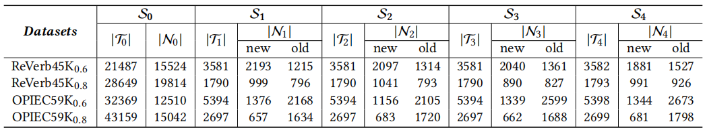

# A Dual-Knowledge Learning Framework for Incremental Open Knowledge Base Canonicalization

## Environment
* Computational platform: Pytorch 2.6.0, NVIDIA RTX A6000 GPU, CUDA Version 12.4
* Development language: Python 3.10
* Libraries are listed in requirements.txt, which can be installed via the command - ``pip install -r requirements.txt``.  - ``ReVerb45K`` 
## Incremental OKB Canonicalization Datasets
We reconstruct four incremental datasets (i.e., **ReVerb45K<sub>0.6</sub>**, **ReVerb45K<sub>0.8</sub>**, **OPIEC59K<sub>0.6</sub>** and **OPIEC59K<sub>0.8</sub>**) based on widely-used static OKB canonicalization datasets - ``ReVerb45K``  and - ``OPIEC59K``. Each reconstructed dataset contains 5 snapshots to simulate a growing OKB. The dataset statistics are shown as follows:



You can download these datasets via the following Google Drive link and then store them in the DKCC/ paths : [Incremental OKB Canonicalization Datasets](https://drive.google.com/drive/folders/1k26raklu9_oszO7ze8ISIIafRPB73LS4?usp=drive_link).

## Reproduce
### Run DKCC on the **ReVerb45K<sub>0.6</sub>**, **ReVerb45K<sub>0.8</sub>** dataset:
```
python train_DKCC_main_reverb.py
```
### Run DKCC on the **OPIEC59K<sub>0.6</sub>** and **OPIEC59K<sub>0.8</sub>** dataset:
```
python train_DKCC_main_opiec.py
```
